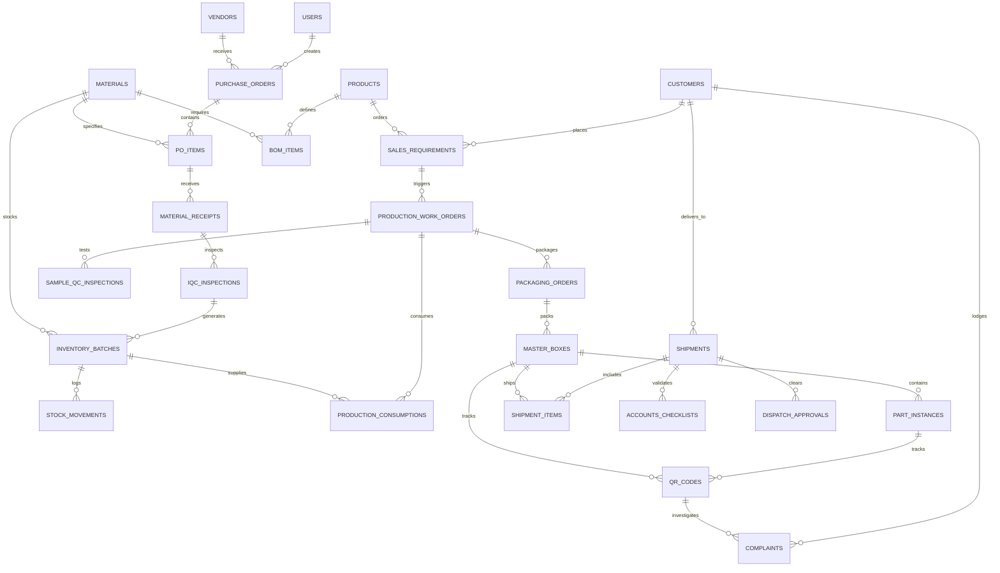

# Manufacturing Operations ERP: Inventory, Production & QR Traceability System

A modern, production-grade enterprise Manufacturing Operations ERP system built to fulfill the primary business specifications detailed in:
1. `Client_Inventory_Production_QR_Workflow_Flowcharts.pdf`
2. `Inventory_Production_Traceability_Requirements_Report.pdf`

---

## 1. Executive Summary & Architecture Overview

This application manages the complete end-to-end lifecycle of a discrete manufacturing enterprise: from inward Purchase Order reception and multi-division Incoming Quality Control (IQC), to automated production scheduling, BOM-based batch consumption, sample quality control, dual-level QR packaging (Part Instance & Master Box), accounts commercial invoice validation, immutable 3-way outward dispatch clearances, and downstream customer complaint & counterfeit forensic verification.

### System Architecture Highlights:
- **Clean Monorepo Architecture**: Segregated `frontend` (React 19, Vite, Tailwind CSS, Redux Toolkit) and `backend` (Node.js ES Modules, Express, Sequelize ORM).
- **Dual-Engine Database Architecture**:
  - **PostgreSQL Ready**: Full schema definitions, indexes, foreign keys, and DDL (`backend/src/config/schema.sql`).
  - **Zero-Config Local SQLite Fallback**: Automatic initialization (`./data/manufacturing_erp.sqlite`) allowing instant local execution and automated testing without external database setup.
- **Role-Based Access Control (RBAC)**: Enforced at both API route middleware and UI navigation levels across 8 distinct manufacturing personas.
- **Zero-Trust Server-Side Clearance**: Critical actions (e.g. Outward Dispatch release, QR generation) strictly validated at the backend service layer.

```
manufacturing-erp/
├── docker-compose.yml              # PostgreSQL + Backend + Frontend multi-container orchestrator
├── package.json                    # Workspace scripts (seed, test, dev, build)
├── README.md                       # Comprehensive system documentation
├── backend/
│   ├── src/
│   │   ├── config/                 # Database dialect configuration, Swagger OpenAPI spec, schema.sql
│   │   ├── constants/              # Roles, Permissions, IQC Divisions, Statuses
│   │   ├── controllers/            # Thin HTTP route handlers
│   │   ├── middleware/             # JWT auth, RBAC authorization, file upload, error handling
│   │   ├── models/                 # 36 Sequelize ORM relational models
│   │   ├── routes/                 # Express API router definitions
│   │   ├── seeders/                # Deterministic realistic Indian enterprise seed data
│   │   ├── services/               # Core business logic, transactions, state machines
│   │   ├── tests/                  # End-to-end automated Vitest & Supertest integration suites
│   │   └── utils/                  # PDFKit Gate Pass, QR Code generator, ExcelJS exporter, ID generators
│   ├── uploads/                    # Local storage for attachments, inspection photos, invoices
│   └── Dockerfile                  # Container definition for backend
└── frontend/
    ├── src/
    │   ├── components/             # Reusable UI widgets: Modal, ConfirmDialog, Badge, Header, Sidebar, etc.
    │   ├── layouts/                # DashboardLayout and AuthLayout
    │   ├── pages/                  # 16 Complete Functional Business Modules
    │   │   ├── auth/               # Login (with 1-click demo switcher) and Profile
    │   │   ├── dashboard/          # Role-based KPI metrics & Recharts analytics
    │   │   ├── master-data/        # Vendors, Customers, Materials, Products + BOM, Users
    │   │   ├── purchase-orders/    # PO intake, line items, material receiving
    │   │   ├── iqc/                # 4-division IQC queues (Paint, Assembly, Store, Basement)
    │   │   ├── inventory/          # Real-time stock, batch breakdown, adjustment modal, ledger
    │   │   ├── sales-requirements/ # Sales intake, approval workflow, production trigger
    │   │   ├── production/         # Work orders, sample prep, BOM batch consumption
    │   │   ├── sample-qc/          # QC inspection queue, pass/fail, defect logging
    │   │   ├── packaging/          # Verification checklist, packaging approval, QR generation trigger
    │   │   ├── qr-traceability/    # Dual-level QR generation, camera/manual scanning, full visual lineage
    │   │   ├── accounts-checklist/ # Invoice checklist, acknowledgement tracking, auto-invalidation
    │   │   ├── dispatch-approvals/ # 3-Way Clearance Hub (Admin, Sales, Accounts)
    │   │   ├── outward-dispatch/   # Dispatch release, vehicle & transporter tracking, PDF Gate Pass
    │   │   ├── complaints/         # Authenticity verification, counterfeit mismatch alerts, CAPA
    │   │   ├── reports/            # 17 enterprise reports with live filtering & Excel export
    │   │   └── audit-logs/         # Comprehensive immutable system audit trail
    │   ├── store/                  # Redux Toolkit global state & auth slice
    │   └── styles/                 # Tailwind CSS styles
    └── Dockerfile                  # Multi-stage Nginx container for frontend
```

---

## 2. Requirements Alignment Matrix

The following table demonstrates how each requirement from the client's PDF specifications has been architected and implemented:

| Client Specification / Requirement | Implementation in System | Technical Verification |
| :--- | :--- | :--- |
| **PO Intake & Receiving** | Line-item PO tracking, received vs pending quantity calculation, counterparty configurability. | `poService.js`, `PurchaseOrdersPage.jsx` |
| **4 IQC Divisions** | Dedicated queues for **Paint, Assembly, Store, Basement**. Inspector assignment, checklist, pass/reject/quarantine. | `iqcService.js`, `IqcInspectionsPage.jsx` |
| **Batch Number Preservation** | Immutable Vendor Batch Number preserved; unique sequential Internal Batch ID generated. | Tested in `workflow.test.js` |
| **Batch-Level Inventory** | Division-wise, status-wise (Available, Reserved, Quarantined, Rejected) inventory with ledger. | `inventoryService.js`, `InventoryPage.jsx` |
| **Sales Requirement Approval** | Admin approval workflow. Rejections route back with remarks; approvals auto-create work order. | `salesService.js`, `SalesRequirementsPage.jsx` |
| **Production & Sample QC** | BOM batch allocation, sample preparation, independent QC gate before full production run. | `productionService.js`, `qcService.js` |
| **Packaging & Dual-Level QR** | Packaging verification checklist; dual QR generation for Part Instances and Master Boxes. | `packagingService.js`, `qrService.js` |
| **Accounts Clearance Checklist** | Commercial invoice verification, customer PO link, acknowledgement record keeping. | `checklistService.js`, `ChecklistPage.jsx` |
| **Strict 3-Way Dispatch Clearance** | Outward dispatch strictly blocked until Admin, Sales, and Accounts all grant clearance. | Tested in `workflow.test.js` & `shipmentService.js` |
| **Clearance Invalidation Rule** | Updating an accounts checklist or shipment line items immediately invalidates clearances. | Tested in `checklistService.js` |
| **End-to-End QR Traceability** | Scans resolve complete lineage: Customer -> Shipment -> Box -> Work Order -> Batches -> Vendor. | `qrService.js`, `QrScannerPage.jsx` |
| **Authenticity vs Fake Validation** | Validates physical batch against digital record; flags mismatches, unregistered codes, or tampered IDs. | Tested in `workflow.test.js` & `complaintService.js` |
| **17 Enterprise Reports** | Interactive reports spanning all 16 modules with Excel export and printable layouts. | `reportService.js`, `ReportsPage.jsx` |

---

## 3. Demo Accounts & Role Permissions

The system seeds 8 standard manufacturing accounts with pre-hashed credentials (`Demo@123`). The frontend includes a **1-Click Demo Account Switcher** directly in the header and login screen for rapid evaluation.

| Role | Email | Password | Primary Responsibilities & Access Scope |
| :--- | :--- | :--- | :--- |
| **Super Admin** | `superadmin@demo.com` | `Demo@123` | Unrestricted global access, Master Data, User CRUD, System Audit Logs, Global Analytics. |
| **Admin** | `admin@demo.com` | `Demo@123` | Sales Requirement Approvals, Production Overseeing, 3-Way Dispatch Clearance Signoff. |
| **Sales** | `sales@demo.com` | `Demo@123` | Sales Requirements Intake, Customer Relationships, Commercial Dispatch Signoff. |
| **Accounts** | `accounts@demo.com` | `Demo@123` | Invoice & Checklist Verification, Payment Acknowledgement, Financial Dispatch Signoff. |
| **IQC Operator** | `iqc@demo.com` | `Demo@123` | Material Receiving, 4-Division Quality Inspections, Vendor Batch Quarantine/Approval. |
| **Production** | `production@demo.com` | `Demo@123` | Work Order Execution, BOM Batch Consumption, Sample Preparation, Packaging Handoff. |
| **QC Operator** | `qc@demo.com` | `Demo@123` | Production Sample Inspection, Defect Recording, Rework Routing, Quality Certification. |
| **Packaging** | `packaging@demo.com` | `Demo@123` | Packaging Condition Checklist, Part & Box QR Code Generation, Label Printing. |

---

## 4. Key Business Rules & Integrity Guarantees

### Rule 1: Strict Three-Way Dispatch Clearance Enforcement
- **Requirement**: No finished goods may exit the factory gate without explicit, concurrent approvals from Admin, Sales, and Accounts.
- **Backend Enforcement**:
  ```javascript
  // src/services/shipmentService.js
  const approvals = await DispatchApproval.findAll({ where: { shipment_id, shipment_version } });
  const hasAdmin = approvals.some(a => a.approver_role === 'Admin' && a.status === 'Approved');
  const hasSales = approvals.some(a => a.approver_role === 'Sales' && a.status === 'Approved');
  const hasAccounts = approvals.some(a => a.approver_role === 'Accounts' && a.status === 'Approved');

  if (!hasAdmin || !hasSales || !hasAccounts) {
    throw new Error('OUTWARD DISPATCH FORBIDDEN: 3-way clearance incomplete!');
  }
  ```
- **Result**: Even if an operator triggers the outward release endpoint directly, the server rejects the request with HTTP 400 until all 3 approvals exist for the active version.

### Rule 2: Automatic Clearance Invalidation on Checklist Revision
- **Requirement**: If Accounts modifies an invoice number, transport details, or item counts after partial or full clearances are granted, all previously granted approvals must be invalidated.
- **Backend Enforcement**: When `updateAccountsChecklist` is executed, the shipment version increments (`version + 1`), and existing approvals are set to `Invalidated`, requiring re-approval.

### Rule 3: Vendor Batch Immutability & Sequential Internal Batching
- **Requirement**: Vendor batch numbers must never be overwritten, and internal batch IDs must be sequential and unique across divisions.
- **Backend Enforcement**: The database maintains `vendor_batch_number` as an immutable audit record and generates `IB-YYYYMMDD-XXXX` as the primary operational tracking identifier.

### Rule 4: QR Traceability & Anti-Counterfeit Verification
- **Requirement**: When customer complaints are logged, the system must cross-check the submitted QR code, product ID, and reported batch number against actual production genealogy.
- **Backend Enforcement**:
  - **Authentic Match**: If QR exists, matches product, and matches the work order's consumed batches -> Status set to `Verified Authentic`, full lineage visual tree rendered.
  - **Counterfeit / Mismatch**: If QR is not found, or belongs to a different product, or reports a batch number never consumed in that production order -> Status flagged as `Mismatch / Possible Counterfeit` with specific discrepancy warnings.

---

## 5. Architectural Clarifications & Assumptions

In response to ambiguous items identified in `Inventory_Production_Traceability_Requirements_Report.pdf`, the system implements the following resolved design decisions:

1. **PO Direction & Counterparty (Section 4.1 of Report)**:
   - *Clarification*: The system implements a **configurable PO counterparty model**:
     - `INWARD` Purchase Orders are linked to **Vendors** for Raw Material procurement.
     - `OUTWARD` Customer Purchase Orders are captured in **Sales Requirements** linked to **Customers**.
2. **Four IQC Divisions Interpretation (Section 4.2 of Report)**:
   - *Clarification*: The 4 divisions (**Paint**, **Assembly**, **Store**, **Basement**) are modeled as distinct inspection work centers with specialized checklists, preventing mixed or uninspected materials from entering general inventory.
3. **Accounts Checklist Acknowledgement (Section 4.3 of Report)**:
   - *Clarification*: Supports multi-channel acknowledgements (`Customer Email`, `Signed Physical PO copy`, `WhatsApp Confirmation`, `Digital Portal Acceptance`) stored with timestamps and upload attachments.
4. **Master Box vs Individual Part QR Hierarchy**:
   - *Clarification*: Master Boxes contain a unique `BOX-` QR code that encodes the aggregated manifest of all enclosed `PART-` QR codes. Scanning the Master Box displays the hierarchy and all enclosed unit serials.

---

## 6. Complete Database Schema (Mermaid ERD)



---

## 7. Step-by-Step Installation & Local Execution

### Prerequisites:
- **Node.js**: v18.0.0 or higher (Node 20+ recommended)
- **npm**: v9.0.0 or higher
- *(Optional)* **Docker & Docker Compose**: for containerized PostgreSQL deployment

---

### Option A: Zero-Config Local Development (SQLite) — Recommended

This mode requires zero database installation. SQLite initializes automatically in `backend/data/manufacturing_erp.sqlite`.

#### 1. Clone & Enter Project
```bash
cd manufacturing-erp
```

#### 2. Install Dependencies
```bash
# Install backend dependencies
cd backend
npm install

# Install frontend dependencies
cd ../frontend
npm install
cd ..
```

#### 3. Seed Realistic Indian Enterprise Data
```bash
cd backend
npm run seed
cd ..
```
*Seeds 8 demo users, 8 vendors, 5 customers, 20 raw materials, 15 finished products with BOM, 15 POs, 40 IQC records, 30 batches, 100+ stock ledger entries, 20 sales requirements, 15 work orders, packaging orders, QR codes, 3-way clearances, shipments, and authentic/fake complaint scenarios.*

#### 4. Run Automated End-to-End Tests
```bash
cd backend
npm test
cd ..
```
*Validates the entire manufacturing workflow and clearance rules with Vitest & Supertest.*

#### 5. Launch Backend Server
In Terminal 1:
```bash
cd backend
npm run dev
```
Backend will be listening at **`http://localhost:5000`**  
- Health check: `http://localhost:5000/api/health`  
- Swagger API Docs: `http://localhost:5000/api/docs`

#### 6. Launch Frontend Client
In Terminal 2:
```bash
cd frontend
npm run dev
```
Frontend will be running at **`http://localhost:5173`**  
Open your browser and navigate to `http://localhost:5173` to log in!

---

### Option B: Production Deployment with PostgreSQL

#### Using Docker Compose (Single Command):
```bash
docker-compose up --build
```
This automatically starts:
- **PostgreSQL 16** on `localhost:5432` with persistent volume and schema initialization
- **Backend API Server** on `http://localhost:5000`
- **Frontend SPA (Nginx)** on `http://localhost:3000`

#### Using Native Local PostgreSQL:
1. Ensure your PostgreSQL service is running and create the database:
   ```sql
   CREATE DATABASE manufacturing_erp;
   ```
2. Update `backend/.env`:
   ```ini
   DB_DIALECT=postgres
   DB_HOST=localhost
   DB_PORT=5432
   DB_NAME=manufacturing_erp
   DB_USER=postgres
   DB_PASSWORD=your_password
   ```
3. Run the database seed script:
   ```bash
   cd backend
   npm run seed
   ```
4. Start both servers:
   ```bash
   npm run dev:backend
   npm run dev:frontend
   ```

---

## 8. Complete REST API Catalog

The backend exposes a structured RESTful API. Complete interactive OpenAPI/Swagger documentation is available at `http://localhost:5000/api/docs`.

### Authentication & Users
- `POST /api/auth/login`: Authenticate and receive signed JWT.
- `GET /api/auth/me`: Fetch authenticated user profile & permissions.
- `GET /api/users`: List system users (Super Admin / Admin).
- `POST /api/users`: Create user with assigned department and role.
- `PUT /api/users/:id`: Edit user details or toggle status.

### Master Data Management
- `GET /api/master/vendors`: List and filter vendors.
- `POST /api/master/vendors`: Create new vendor.
- `GET /api/master/customers`: List and filter customers.
- `POST /api/master/customers`: Create customer.
- `GET /api/master/materials`: Raw materials catalog with reorder thresholds.
- `GET /api/master/products`: Finished products with multi-level BOM components.

### Purchase Orders & Receiving
- `GET /api/purchase-orders`: List POs with status filters.
- `POST /api/purchase-orders`: Create PO with line items.
- `POST /api/purchase-orders/:id/receive`: Receive physical material items against PO line.

### IQC (Incoming Quality Control)
- `GET /api/iqc/inspections`: List inspections filtered by division (`Paint`, `Assembly`, `Store`, `Basement`).
- `POST /api/iqc/inspections`: Create new inspection record against material receipt.
- `POST /api/iqc/inspections/:id/action`: Execute Accept / Reject / Quarantine decision and generate sequential Internal Batch ID.

### Inventory & Stock Movements
- `GET /api/inventory/summary`: Centralized stock levels across raw materials & finished goods.
- `GET /api/inventory/batches`: Granular batch-level stock with division breakdown.
- `GET /api/inventory/ledger`: Complete immutable stock movement transaction log.
- `POST /api/inventory/adjust`: Authorized stock adjustment with audit justification.

### Sales Requirements & Approvals
- `GET /api/sales/requirements`: List requirements with priority & status.
- `POST /api/sales/requirements`: Submit new sales requirement.
- `POST /api/sales/requirements/:id/review`: Admin approve/reject action (auto-spawns work order on approval).

### Production & Sample Quality Control
- `GET /api/production/work-orders`: Work orders tracking with progress stages.
- `POST /api/production/work-orders/:id/sample-prep`: Submit prepared sample for QC inspection.
- `POST /api/qc/inspections/:id/action`: Sample QC Pass/Fail with defect logging.
- `POST /api/production/work-orders/:id/consume`: Consume raw material batches based on BOM.
- `POST /api/production/work-orders/:id/complete`: Complete production run and transfer parts to Packaging.

### Packaging & QR Traceability
- `GET /api/packaging/orders`: Packaging queue and order tracking.
- `POST /api/packaging/orders/:id/action`: Complete packaging inspection checklist and trigger dual QR generation.
- `GET /api/qr/resolve/:code`: Resolve complete visual genealogy and lifecycle of a Part or Box QR.
- `GET /api/qr/generate-sheet`: Generate printable multi-label PDF sticker sheet.

### Accounts Checklist & 3-Way Dispatch Clearance
- `GET /api/checklists`: List accounts clearance checklists.
- `PUT /api/checklists/:id`: Update checklist items (automatically invalidates active approvals).
- `GET /api/dispatch-approvals/shipment/:id`: View status of Admin, Sales, and Accounts approvals.
- `POST /api/dispatch-approvals/sign`: Grant clearance signoff (Admin, Sales, or Accounts).
- `POST /api/shipments/:id/dispatch`: Execute physical outward release (strictly enforces 3-way clearance).
- `GET /api/shipments/:id/gate-pass`: Generate official PDF Outward Gate Pass document.

### Customer Complaints & Anti-Counterfeit Verification
- `GET /api/complaints`: List complaints and investigation statuses.
- `POST /api/complaints`: Register complaint with QR code verification and mismatch flagging.
- `PUT /api/complaints/:id/capa`: Record root cause analysis, CAPA actions, and close investigation.

### Reports & Analytics
- `GET /api/reports/:reportKey`: Execute any of the 17 business reports.
- `GET /api/reports/:reportKey/export`: Export report dataset directly to formatted Excel workbook (.xlsx).

---

## 9. Automated Testing Verification

The backend includes a comprehensive integration test suite (`backend/src/tests/workflow.test.js`) executed with Vitest and Supertest:

```bash
cd backend
npm test
```

### Verified Test Scenarios:
1. **Full Manufacturing Lifecycle**:
   - Vendor & Customer setup -> Material & Product BOM creation -> PO issuance -> Material Receipt.
   - IQC Inspection across divisions -> Vendor batch preservation -> Internal Batch ID generation.
   - Sales Requirement creation -> Admin Review & Approval -> Automatic Work Order generation.
   - Sample Preparation -> Sample QC Pass -> Multi-batch Raw Material consumption.
   - Packaging Checklist verification -> Dual Part & Master Box QR generation.
2. **Clearance Security Checks**:
   - Accounts commercial invoice validation.
   - **Enforcement Check**: Attempt outward dispatch before 3-way approval -> **Expected 400 error caught**.
   - Admin, Sales, and Accounts sequential approval recording.
   - Successful outward dispatch execution & PDF Gate Pass generation.
3. **QR Traceability & Anti-Counterfeit Verification**:
   - Scan Part QR code -> Full digital lineage from Vendor to Shipment resolved.
   - File legitimate complaint -> Verified authentic.
   - File complaint with mismatched/tampered batch details -> Server flags `Mismatch / Possible Counterfeit`.

---

## 10. License

Built for enterprise manufacturing operations. All rights reserved.
